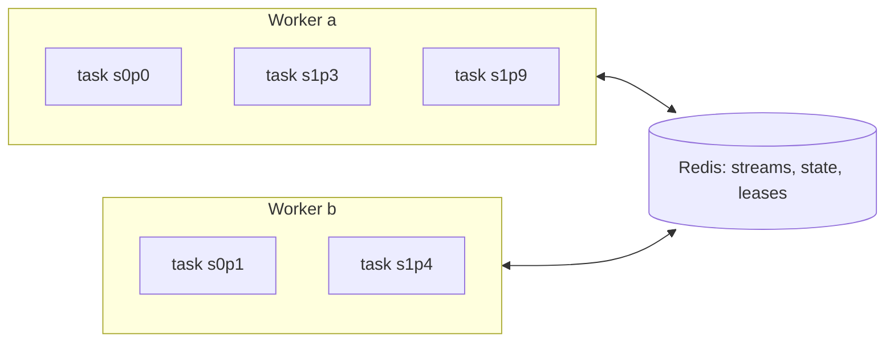

# Redstream design

Redstream is a Flink-style stream processing engine that uses Redis as its log, its state
store and its coordination service. This document describes how it works, why it is built
this way, and where its guarantees end.

Contents

1. Goals and non-goals
2. The core idea
3. Deployment model
4. From DataStream API to stages
5. Redis data layout
6. The commit protocol
7. The keyBy shuffle
8. Ownership: leases, epochs, fencing
9. Recovery
10. Time, watermarks and windows (planned)
11. Backpressure
12. Sinks and end-to-end guarantees
13. Failure model and limits
14. Comparison with Flink
15. Milestones
16. Open questions

---

## 1. Goals and non-goals

Goals:

- **Exactly-once state updates** for keyed processing: after any crash, every input record's
  effect on state and on emitted output happens once.
- **A DataStream API that feels like Flink's**: `map`, `flatMap`, `filter`, `keyBy`,
  keyed process functions with `ValueState`, event-time windows.
- **Nothing to operate except Redis**: no JobManager, no ZooKeeper, no external checkpoint store.
- **Recovery that is local and fast**: a failed partition restores itself, the rest of the job keeps running.
- **Small enough to read**: the fault-tolerance core is two Lua scripts and one Java class.

Non-goals (for now):

- State larger than memory. Redis is the state store, so state must fit in RAM across the cluster.
- Durability stronger than the Redis deployment's (see section 13).
- Joins, unions and multi-input operators. The planner supports linear pipelines with fan-out.
- Changing the number of key groups of a running job.

## 2. The core idea

Flink gets exactly-once from **global consistent snapshots**: barriers flow through the job,
each operator snapshots its state when the barrier passes, and a checkpoint is complete when
every operator has acknowledged. Recovery rolls the *whole job* back to the last checkpoint.

Redis offers something Flink's runtime doesn't have: **server-side scripts that update several
keys atomically**, provided the keys live in the same hash slot. Redstream builds on that:

> Put everything belonging to one partition (its input offset, its keyed state, its pending
> outputs) under one hash tag. Then a single Lua call can commit a processed batch atomically:
> state changes, outputs and the new input offset all land together, or none do.

That turns exactly-once into a **per-partition, per-batch** transaction, closer to Kafka
Streams' transactional model than to Flink's. There are no barriers and no global checkpoint.
The one place atomicity cannot reach is across partitions (the shuffle), which is handled with
idempotent delivery and sequence-number dedup (section 7).

## 3. Deployment model

Redstream runs **library-style, like Kafka Streams**:

- Every worker process runs the same `main()`, which builds the same `JobDefinition`.
- Every worker plans it into the identical `JobGraph`. Planning is deterministic, so nothing
  about the job (operators, closures, serdes) is ever serialized or shipped.
- Workers coordinate only through Redis: they heartbeat into a ZSET, compute the same
  partition assignment from the live-worker list, and take ownership through leases.

To scale out, start another worker with the same code. To scale in, stop one: its leases are
released (or expire) and other workers take its partitions.

One consequence for the API: a worker runs many partitions in one JVM, and functions are not
copied per partition the way Flink copies them by deserialization. So:

- Stateless functions (`map`, `flatMap`, `filter`, key selectors) are shared and must be
  stateless and thread-safe.
- Keyed functions keep state handles in fields, so `KeyedStream.process` takes a
  `Supplier` (`CountWords::new`) and calls it once per partition, exactly like Kafka Streams'
  `ProcessorSupplier`. The runtime rejects a supplier that returns the same instance twice.
  (This was a real bug during development: one shared instance made every key group on a
  worker write through the last-opened partition's state handle.)



## 4. From DataStream API to stages

### 4.1 Lazy transformations

Each API call records a `Transformation` and returns a new stream; nothing executes. The
transformation types mirror Flink's:

| Transformation | Created by | Notes |
|---|---|---|
| `SourceTransformation` | `env.fromSource(...)` | One source partition per Redis stream |
| `OneInputTransformation` | `map`, `flatMap`, `filter`, `process`, `window().reduce()` | Carries an `OperatorSpec` and the output `Serde` |
| `PartitionTransformation` | `keyBy` | Not an operator: marks a hash-partitioned edge |
| `SinkTransformation` | `sinkTo(...)` | Appends to a Redis stream |

Every type-changing call takes an explicit `Serde`. Java erases generics, so at runtime the
engine cannot tell what a `DataStream<Event>` holds; Flink solves the same problem with
`TypeInformation`. Explicit serdes are simpler and make the wire format obvious.

### 4.2 Planning and chaining

`LogicalPlanner` walks transformations in id order (a topological order, since inputs are
always created first) and groups them into **stages**:

- A source starts a stage.
- A `PartitionTransformation` (keyBy) starts a new stage and adds a shuffle output to the upstream stage.
- Any other operator joins its input's stage (operator chaining).
- Every stage must end in a sink or a keyBy, otherwise its results would be discarded.

Inside a stage, records pass between operators by **direct method call**: no serialization,
no queue. This is the same as Flink's operator chaining and is where most per-record cost is saved.

```
env.fromSource(lines)            ─┐
   .flatMap(split)                │ stage 0 (source partitions = number of source streams)
   .keyBy(word)                  ─┘   → shuffle through Redis
   .process(CountWords::new)     ─┐
   .sinkTo(counts)               ─┘ stage 1 (partitions = key groups)
```

### 4.3 Partitions and key groups

| Stage kind | Partitions | Input |
|---|---|---|
| Source stage | One per source stream | The user's Redis stream |
| Keyed stage | `maxParallelism` key groups (default 128) | One input stream per key group |

A record's key group is `murmur3(serializedKey) mod maxParallelism`. Hashing the *serialized*
key (not `hashCode()`) keeps the mapping identical across JVMs and runs.

The key group is the **unit of everything** in a keyed stage: input stream, state, commit,
lease and ownership. Workers own sets of key groups. Rescaling moves whole key groups and never
splits one, the same idea as Flink's key groups or Kafka's fixed partition count.
`maxParallelism` therefore caps how many workers a keyed stage can use and cannot change
without a state migration.

## 5. Redis data layout

All keys of one partition share a hash tag `{job:s<stage>:p<partition>}`, so in Redis Cluster
they live in one slot and one Lua script can touch all of them.

| Key | Type | Contents |
|---|---|---|
| `{job:sS:pP}:meta` | HASH | `epoch`, `in_offset`, `out_seq`, `fwd_offset`, `wm`, `seen:<producer>` |
| `{job:sS:pP}:in` | STREAM | Shuffled input (keyed stages only) |
| `{job:sS:pP}:state` | HASH | Keyed state: field = `[operator id][state name][key]` |
| `{job:sS:pP}:out` | STREAM | Outbox: committed outputs waiting to be forwarded |
| `{job:sS:pP}:timers` | ZSET | Event-time timers (milestone 4) |
| `{job:sS:pP}:lease` | STRING | Owning worker id, with TTL |
| `{job}:workers` | ZSET | Live workers, score = last heartbeat (Redis server time) |

Entries in an outbox, a shuffled input stream and a sink stream carry:
`p` (producer id, e.g. `s0p1`), `s` (producer sequence number), `ts` (event time), `v` (payload).
Outbox entries also carry `dst`, the destination stream.

`KeySpace` and `PartitionKeys` are the only classes that build key names. Job names are
restricted to `[a-z0-9-]` because they go inside hash tags.

## 6. The commit protocol

### 6.1 Task loop

Each owned partition runs a `PartitionTask` on a virtual thread:

```mermaid
sequenceDiagram
  participant T as PartitionTask
  participant R as Redis (one hash slot)
  participant D as Downstream / sink stream
  T->>R: restore: HGETALL meta, HGETALL state
  loop while lease held
    T->>R: XREAD outbox after fwd_offset
    T->>D: XADD each entry to its dst
    T->>R: forward_ack.lua (fenced): fwd_offset, XTRIM outbox
    T->>R: XREAD input after in_offset (COUNT batchSize)
    Note over T: dedup by (producer, seq); run operator chain;<br/>buffer state writes and outputs in memory
    T->>R: commit.lua (fenced): state, outbox, in_offset, seen, wm
  end
```

### 6.2 `commit.lua`

One call per batch. Keys: `meta`, `state`, `out` (all in one slot). In order, it:

1. Checks `meta.epoch == caller's epoch`; otherwise returns `FENCED` and writes nothing.
2. Applies state writes (`HSET`) and deletes (`HDEL`).
3. Appends each output to the outbox with the next value of `out_seq`.
4. Records the highest sequence number seen from each upstream producer (`seen:<producer>`).
5. Sets `in_offset`, `wm` and `out_seq`.

Redis runs a script without interleaving other commands, so steps 1 to 5 are atomic. Lua
errors after a write do not roll back in Redis, so the script validates (step 1) before it
writes anything, and its remaining steps cannot fail on well-formed arguments.

### 6.3 Invariants

For every partition, at all times:

- **I1.** `state` reflects exactly the input entries up to and including `in_offset`.
- **I2.** The outbox contains every output produced by those entries, in order, numbered
  `1..out_seq` without gaps (entries `<= fwd_offset` may have been trimmed after delivery).
- **I3.** Every outbox entry up to `fwd_offset` has been appended to its destination at least once.
- **I4.** Only the holder of the current epoch can change `meta`, `state` or `out`.

I1 and I2 hold because they change only inside `commit.lua`. I3 holds because `fwd_offset`
moves only after the XADDs. I4 is the fencing in both scripts.

### 6.4 Why there is no rollback path

Nothing reaches Redis except through `commit.lua`. A failure anywhere else (user code throwing,
a crash, a lost connection) ends the task; the in-memory batch is discarded with it; the worker
starts a fresh task that restores from Redis and re-reads from `in_offset`. Re-reading
reprocesses exactly the records whose effects were never committed.

## 7. The keyBy shuffle

The outbox is in the producer's slot; the destination input stream is in another slot (and in
Redis Cluster, often another node). They cannot be updated atomically, so the shuffle is made
**idempotent** instead:

1. The producer's commit puts outputs in its own outbox, numbered by `out_seq`. (atomic)
2. The forwarder copies outbox entries to their destinations, preserving `(p, s)`. (not atomic)
3. The forwarder acks progress with `forward_ack.lua`. (atomic, fenced)

If a crash happens between 2 and 3, the next owner re-forwards the same entries with the same
`(p, s)`. The consumer drops any entry with `s <= seen[p]`, and `seen[p]` is committed in the
same transaction as the state it protects.

This is correct because, for each (producer, destination) pair, sequence numbers arrive in
increasing order: the outbox is ordered, and only the partition's current owner forwards it.
During an ownership handover the old and new owners can both forward for a short time, but the
new owner restarts from the acked `fwd_offset`, so anything it sends again is a prefix
duplicate that the max-seen rule drops.

Sequence numbers are assigned inside `commit.lua` and persisted in the outbox, so a replay
reuses the original numbers. That is what makes the dedup sound; numbering at forward time
would not be.

## 8. Ownership: leases, epochs, fencing

### 8.1 Membership and assignment

Every `leaseTtl / 3` each worker runs one reconcile pass:

1. `heartbeat.lua`: ZADD itself with Redis server time, evict entries older than the TTL,
   return the live list. Server time avoids clock skew between workers.
2. For each partition in a fixed global order, compute the preferred owner as
   `liveWorkers[index mod n]`. Every worker computes the same answer.
3. Preferred and not running: acquire the lease and start a task. Not preferred but running:
   stop the task, then release the lease so the new owner does not wait for the TTL.

Assignment is advice. **Leases are the source of truth**: during membership changes two
workers may briefly disagree about who should own a partition, but only one can hold its lease.

### 8.2 Epochs and fencing

`lease.lua` bumps `meta.epoch` whenever a lease is newly acquired, and returns it. The task
passes that epoch to every `commit.lua` and `forward_ack.lua` call.

A worker that stalls past its TTL (a long GC pause, a network partition) loses the lease, and
the next owner bumps the epoch. When the stalled worker wakes up, its next commit fails with
`FENCED` and it stops. Without this check, the zombie's commit would overwrite the new owner's
state: TTL leases alone are not safe. This is the standard fencing-token pattern.

The epoch lives in the partition's own `meta` hash, so the check is in the same atomic script
as the write it guards. A separate lock service could not give that guarantee.

## 9. Recovery

| Failure | What happens | Time to recover |
|---|---|---|
| Task throws (bug, bad record, Redis error) | Task ends; next reconcile restarts it from Redis, same epoch | ~`leaseTtl / 3` |
| Worker process dies | Its leases expire; preferred owners acquire with new epochs | ~`leaseTtl` |
| Worker stalls, then resumes | Fenced on its next write; stops its tasks | Immediate on resume |
| Worker leaves gracefully | Tasks stop after their current batch; leases released | ~`leaseTtl / 3` |

Recovery is per partition. A crash in one key group never rolls back another, unlike Flink,
where a failure restarts the affected pipelined region from the last global checkpoint.

Restore cost in milestone 1 is a full `HGETALL` of the key group's state. Lazy loading with a
bounded cache is a later optimization and does not change the protocol.

## 10. Time, watermarks and windows (planned, milestone 4)

What exists today: sources assign event timestamps (`TimestampAssigner`, defaulting to the
Redis entry time), compute `max timestamp - maxOutOfOrderness` as the watermark, and commit
it with each batch. Timestamps travel with every shuffled record (`ts`).

Plan:

- Each producer periodically emits a **watermark entry** into each downstream input stream it
  writes to. A keyed partition tracks the latest watermark per producer and uses the minimum,
  as Flink does across input channels. Idle producers need an idleness timeout, or one quiet
  source partition stalls every window.
- Event-time timers live in the `:timers` ZSET, member = `[key][timestamp]`. When the
  watermark advances, `commit.lua` pops due timers in the same transaction that commits the
  batch, so a timer firing and its outputs are exactly-once too.
- `window().reduce()` keeps one accumulator per (key, window) in keyed state and registers a
  timer at `window.maxTimestamp()`. Records later than `allowedLateness` go to a side output.

## 11. Backpressure

Flink pushes records with credit-based flow control. Redstream pulls, like a Kafka consumer:
each task reads its input at its own pace, so a slow partition never blocks a fast one. The
risk moves to **unbounded input streams**: if a keyed stage falls behind, its `:in` streams
grow in Redis memory.

Planned: producers check the destination streams' length (`XLEN`) and pause forwarding above
a threshold. Forwarding is already decoupled from processing by the outbox, so pausing it
naturally slows upstream commits once the outbox grows past its own bound.

Reads never use `XREAD BLOCK`, because all tasks in a worker share one multiplexed connection
and a blocking read would stall every other task. Idle tasks sleep for `pollInterval`.

## 12. Sinks and end-to-end guarantees

Sinks are delivered through the same outbox and forwarder, so delivery into a sink stream is
**at-least-once**: a crash between forwarding and acking re-appends entries. Every sink entry
carries `(p, s)`, so a consumer that keeps the highest `s` per `p` gets exactly-once. The
end-to-end test does exactly that and checks that, after dedup, there is one sink entry per
input record.

For a sink consumer that can't dedup, a later option is a sink that writes to a key in the
producer's own slot (e.g. a per-partition result hash), which can be part of `commit.lua` and
therefore exactly-once without dedup.

## 13. Failure model and limits

Exactly-once holds **as long as Redis does not lose acknowledged writes**. Know where that breaks:

- **Async replication.** A primary can acknowledge a commit and fail before replicating it. The
  promoted replica then has older state, older offsets and older outboxes, consistent with each
  other per partition, but some outputs already forwarded downstream may correspond to commits
  that no longer exist. `WAIT` reduces the window but does not close it.
- **Persistence.** With `appendfsync everysec`, a crash of a single node can lose about one
  second of commits, with the same effect. `appendfsync always` closes this at a large throughput cost.
- **Memory.** State, input streams and outboxes all live in RAM. Streams are trimmed after
  forwarding, but a stalled stage grows its inputs without bound until backpressure exists.
- **Script size and latency.** A commit is one script call. Large batches block the shard for
  their duration; `batchSize` trades throughput against tail latency for other clients of the shard.
- **Key group count is fixed** for the life of the job.

Running on Valkey or Redis 7+ is assumed (scripts use `XTRIM MINID` and `TIME` before writes,
which needs Redis 6.2+ with effects replication).

## 14. Comparison with Flink

| Concern | Flink | Redstream |
|---|---|---|
| Control plane | JobManager schedules subtasks into TaskManager slots | No master; workers heartbeat and lease partitions in Redis |
| Shipping the job | Serialize the JobGraph and user closures | Every worker runs the same `main()`; nothing is serialized |
| Unit of parallelism | Subtask; keyed state split into key groups | Partition: source stream or key group |
| Operator chaining | Same-parallelism forward edges fused into one task | Everything between source/keyBy and the next keyBy/sink |
| Shuffle transport | Netty network buffers with credit-based flow control | Outbox → forwarder → per-key-group Redis stream |
| State backend | Heap or RocksDB, local to the TaskManager | Redis hash in the key group's slot |
| Fault tolerance | Global barrier checkpoints (Chandy-Lamport style) | Per-batch atomic commit per partition, plus seq-number dedup |
| Recovery scope | Restart region from last completed checkpoint | Just the failed partition, from its last commit |
| Commit cost | Cheap per record; periodic async snapshots | One script call per batch, synchronous |
| Exactly-once sink | Two-phase commit tied to checkpoint completion | Idempotent sink entries `(p, s)`; consumer dedups |
| Zombie protection | Attempt ids; JobManager restarts tasks | Epoch fencing inside each commit script |

## 15. Milestones

| # | Milestone | Status |
|---|---|---|
| 1 | Single stage: source → chained operators → sink, atomic commit, restore | Done |
| 2 | keyBy shuffle with outbox, forwarder and (producer, seq) dedup | Done |
| 3 | Leases, epochs, fencing, membership, assignment | Done |
| 4 | Event time: watermark propagation, timers in `commit.lua`, windowed reduce | Planned |
| 5 | Fault injection: crash points, worker kill and join, correctness checker | Done (`ExactlyOnceIT`); network partitions and Redis failover planned |
| 6 | Backpressure on input stream length; lazy state loading | Planned |
| 7 | Benchmarks: throughput and p99 vs batch size, vs a Flink baseline | Planned |
| 8 | Rescaling `maxParallelism` with an offline state migration tool | Planned |

## 16. Open questions

- **Sticky assignment.** Round-robin by worker index moves many partitions when a worker joins.
  Rendezvous hashing would move only about `1/n` of them.
- **Batch size adaptation.** Larger batches mean fewer script calls but longer slot blocking.
  Adapt to observed script latency?
- **Watermarks with idle sources.** Which idleness rule, and should watermark entries piggyback
  on data entries to save stream writes?
- **Very hot keys.** One key group is one task; a hot key cannot be split. Local pre-aggregation
  in the producer stage would help for associative reductions.
