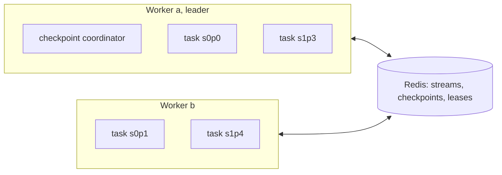
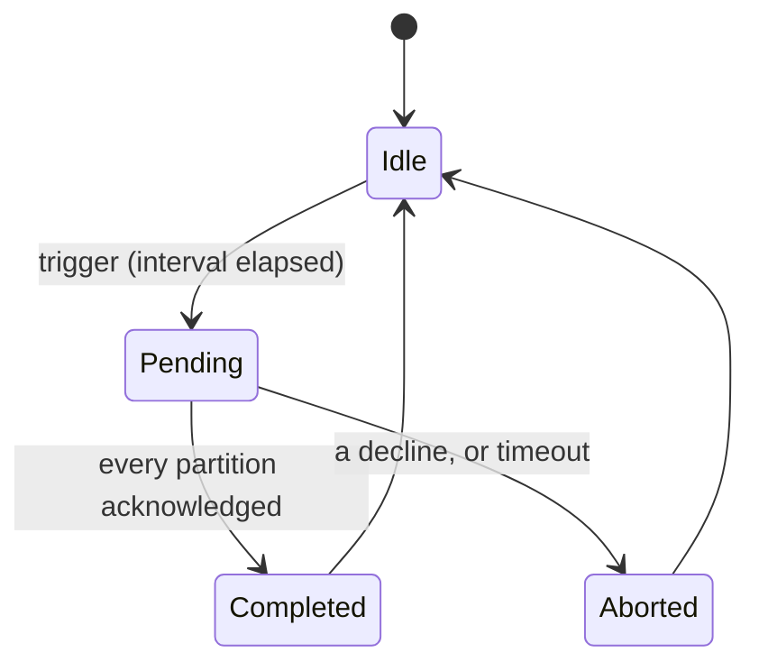

# Redstream design

Redstream is a stream processing engine that works like Flink and uses Redis for everything
around it: Redis Streams carry the data, Redis holds the checkpoints, and workers coordinate
through Redis. This document describes the design. [PLAN.md](PLAN.md) is the order to build
it in.

Contents

1. Goals and non-goals
2. The core idea
3. Deployment model
4. From DataStream API to stages
5. State backends
6. Checkpoints
7. Barriers and alignment
8. Leadership, ownership and fencing
9. Recovery
10. Sinks and end-to-end guarantees
11. Redis data layout
12. Failure model and limits
13. Comparison with Flink
14. Open questions

---

## 1. Goals and non-goals

Goals:

- **Flink's model, small enough to read**: operator chains, keyed state backends, checkpoint
  barriers, a checkpoint coordinator and global recovery, each in a few classes.
- **A DataStream API that feels like Flink's**: `map`, `flatMap`, `filter`, `keyBy`, keyed
  process functions with `ValueState`.
- **Exactly-once state**, and exactly-once output through a two-phase-commit sink.
- **Nothing to operate except Redis**: no JobManager process, no ZooKeeper, no S3.
- **Pluggable state backends**: state on the heap or in RocksDB, as in Flink.

Non-goals (for now):

- Joins, unions and multi-input operators. The planner supports linear pipelines with fan-out.
- Changing the number of key groups of a running job.
- Checkpoint storage outside Redis (the interface allows it later).

## 2. The core idea

Flink gets exactly-once from **global consistent snapshots**. The coordinator asks the sources
to start checkpoint `n`. Sources write a **barrier** into their output. Each task snapshots its
state when barrier `n` has arrived on all of its inputs, then passes the barrier on. Checkpoint
`n` is complete when every task has acknowledged. After a failure the whole job rolls back to
the last completed checkpoint and the sources replay from there.

Redstream follows that model and maps each part onto Redis:

| Flink part | In Redstream |
| --- | --- |
| Network channels between tasks | Redis Streams, one per source partition and per key group |
| JobManager | Whichever worker holds the leader lease |
| RPC between JobManager and tasks | Keys in Redis that both sides read and write (`JobControl`) |
| Checkpoint storage (S3, HDFS) | Redis keys (`CheckpointStorage`) |
| State backend | Heap or RocksDB, local to the worker |

## 3. Deployment model

Redstream runs **library-style**, like Kafka Streams:

- Every worker process runs the same `main()`, which builds the same `JobDefinition`.
- Every worker plans it into the identical `JobGraph`. Planning is deterministic, so nothing
  about the job (operators, closures, serdes) is ever serialized or shipped.
- Workers heartbeat into a ZSET, compute the same partition assignment from the live-worker
  list, and take ownership of partitions through leases.
- One worker also holds the **leader** lease and runs the checkpoint coordinator.

To scale out, start another worker with the same code. To scale in, stop one.

A worker runs many partitions in one JVM, and functions are not copied per partition the way
Flink copies them by deserialization. So stateless functions (`map`, `flatMap`, `filter`, key
selectors) must be thread-safe, and `KeyedStream.process` takes a `Supplier` that is called
once per partition.



## 4. From DataStream API to stages

### 4.1 Lazy transformations

Each API call records a `Transformation` and returns a new stream; nothing executes. The
transformation types mirror Flink's:

| Transformation | Created by | Notes |
|---|---|---|
| `SourceTransformation` | `env.fromSource(...)` | One source partition per Redis stream |
| `OneInputTransformation` | `map`, `flatMap`, `filter`, `process` | Carries an `OperatorSpec` and the output `Serde` |
| `PartitionTransformation` | `keyBy` | Not an operator: marks a hash-partitioned edge |
| `SinkTransformation` | `sinkTo(...)` | Writes to a Redis stream |

Every type-changing call takes an explicit `Serde`, because Java erases generics. Flink solves
the same problem with `TypeInformation`.

### 4.2 Planning and chaining

`LogicalPlanner` groups transformations into **stages**:

- A source starts a stage.
- A `keyBy` starts a new stage and adds a shuffle output to the upstream stage.
- Any other operator joins its input's stage (operator chaining).
- Every stage must end in a sink or a keyBy.

Inside a stage, records pass between operators by **direct method call**: no serialization, no
queue. This is Flink's operator chaining.

```
env.fromSource(lines)            ─┐
   .flatMap(split)                │ stage 0 (partitions = number of source streams)
   .keyBy(word)                  ─┘   → shuffle through Redis
   .process(CountWords::new)     ─┐
   .sinkTo(counts)               ─┘ stage 1 (partitions = key groups)
```

### 4.3 Partitions and key groups

| Stage kind | Partitions | Input |
|---|---|---|
| Source stage | One per source stream | The user's Redis stream |
| Keyed stage | `maxParallelism` key groups (default 128) | One input stream per key group |

A record's key group is `murmur3(serializedKey) mod maxParallelism`. Hashing the serialized key
keeps the mapping identical across JVMs and runs.

The key group is the **unit of state, ownership and snapshots**. Rescaling moves whole key
groups and never splits one, the same idea as Flink's key groups. `maxParallelism` caps how
many workers a keyed stage can use.

## 5. State backends

Keyed state lives in a `KeyedStateBackend`, one per key group, created by a `StateBackend`:

| Backend | Where state lives | Snapshot | Good for |
| --- | --- | --- | --- |
| `HashMapStateBackend` | A Java map on the heap | Whole map serialized into one blob | Small state, learning |
| `EmbeddedRocksDBStateBackend` | RocksDB on the worker's disk | SST files; incremental (only new files) | State larger than memory |

State is addressed by `[operator id][state name][key]` (`StateKeys`). Writes go straight into
the backend: there is no per-batch buffer, because consistency comes from snapshots taken at
barriers.

A snapshot returns a `KeyedStateHandle`: the backend's name and the blob names it wrote. With
incremental RocksDB checkpoints, SST files never change once written, so a blob can be shared
by several checkpoints.

## 6. Checkpoints

The **checkpoint coordinator** runs on the leader:



1. **Trigger:** pick the next id and publish it in `JobControl`. Ids keep increasing across
   leaders.
2. **Inject:** source tasks poll the requested id between batches. A source records its read
   position, acknowledges, and writes barrier `n` into every downstream stream.
3. **Align and snapshot:** keyed tasks align barriers (section 7), snapshot their state to
   `CheckpointStorage`, and acknowledge with the state handle.
4. **Complete:** when every partition of every stage has acknowledged, the coordinator commits
   `CheckpointMetadata` (one `TaskSnapshot` per partition) and makes it the latest. Then it
   tells tasks (`notifyCheckpointComplete`) and discards old checkpoints.

At most one checkpoint is pending at a time. An aborted checkpoint never completes, and the job
keeps running.

## 7. Barriers and alignment

A barrier is a stream entry in the same stream as the data, with a kind field that marks it.

A keyed task's single input stream mixes entries from every upstream partition (the `p` field
names the producer). Once barrier `n` has arrived from producer A, A's later records belong to
checkpoint `n + 1`. The task holds them back until barrier `n` has arrived from every producer,
then snapshots, then processes what it held back. This is Flink's **aligned checkpoint**.

Every upstream partition sends every barrier to every downstream key group, even key groups it
sent no data to. Otherwise a key group would wait for a barrier that never comes.

## 8. Leadership, ownership and fencing

Two kinds of lease, both TTL keys in Redis with an epoch that increases on every new holder:

| Lease | Held by | Epoch fences |
| --- | --- | --- |
| Partition lease (`{job:sS:pP}:lease`) | The worker running that partition | Writes by a task that lost its partition |
| Leader lease (`{job}:leader`) | The worker running the coordinator | Checkpoint requests, restarts and checkpoint commits by an old leader |

A worker that stalls past its TTL (a long GC pause, a network partition) loses its lease, and
the next holder bumps the epoch. When the stalled worker wakes up, its next fenced write fails
with `FencedException` and it stops. TTL leases alone are not safe; the epoch check inside the
same atomic script as the write is what makes them safe.

Task acknowledgements carry the **attempt** (section 9), so acks from tasks of an earlier
attempt are ignored.

## 9. Recovery

Recovery is **global**, as in Flink:

1. A task fails, or partition ownership changes (a worker joins or leaves).
2. The leader starts a new **attempt** (`JobControl.requestRestart`).
3. Every worker stops all its tasks.
4. In-flight data from the old attempt is deleted: keyed input streams are named per attempt.
5. Every task restores from the latest completed checkpoint: sources seek to their recorded
   offsets, keyed tasks restore their state handles.
6. Sources replay everything after the checkpoint.

Ownership changes need a global restart because one partition restored on its own would be at
a different point in time from the rest of the job.

This is the main trade-off against a per-partition design: recovery is simple and always
consistent, but one failure rewinds the whole job.

## 10. Sinks and end-to-end guarantees

| Sink | Guarantee | How |
| --- | --- | --- |
| Plain stream append | At-least-once | Records after the last checkpoint are written again after a restart |
| Two-phase-commit sink | Exactly-once | Output is staged per checkpoint and made visible only when the checkpoint completes |

The two-phase-commit sink follows Flink's `TwoPhaseCommitSinkFunction`: begin a transaction
after each barrier, write into it, pre-commit at the next barrier (the transaction goes into
the task's snapshot), commit on `notifyCheckpointComplete`. Commit must be idempotent, because
a restored task commits again every transaction in its snapshot.

Output then appears once per checkpoint interval rather than right away. That is the latency
cost of exactly-once output, in Flink too.

## 11. Redis data layout

All keys of one partition share the hash tag `{job:sS:pP}`; all job-level keys share `{job}`.
Keys in one tag live in one hash slot, so one Lua script can update them atomically.

| Key | Type | Contents |
|---|---|---|
| `{job:sS:pP}:meta` | HASH | `epoch` (partition owner fencing) |
| `{job:sS:pP}:lease` | STRING | Owning worker id, with TTL |
| `{job:sS:pP}:in:a<attempt>` | STREAM | Keyed input for one attempt: records and barriers |
| `{job}:workers` | ZSET | Live workers, score = last heartbeat (Redis server time) |
| `{job}:leader` | STRING | Leader worker id, with TTL |
| `{job}:control` | HASH | `leader_epoch`, `attempt`, requested checkpoint id and time |
| `{job}:ckpt:<id>:acks` | HASH | Acknowledgements: partition → `TaskSnapshot` |
| `{job}:ckpt:<id>:declines` | HASH | Declines: partition → reason |
| `{job}:ckpt:<id>:meta` | STRING | `CheckpointMetadata` of a completed checkpoint |
| `{job}:ckpt:latest` | STRING | Id of the latest completed checkpoint |
| `{job}:blob:<name>` | STRING | State blobs written by state backends |

Stream entries carry `v` (payload), `ts` (event time), `p` (producer partition) and a kind
field (record or barrier). `KeySpace` and `PartitionKeys` are the only classes that build key
names.

## 12. Failure model and limits

Exactly-once holds **as long as Redis does not lose acknowledged writes**:

- **Async replication.** A primary can acknowledge a checkpoint commit and fail before
  replicating it. The promoted replica may then lack the latest checkpoint, and the job
  restores from an older one. State stays consistent; a two-phase-commit sink may have made
  output visible for a checkpoint that is now lost.
- **Persistence.** With `appendfsync everysec`, a single-node crash can lose about one second
  of writes, with the same effect.
- **Memory.** Data streams and checkpoint blobs live in Redis RAM. Streams must be trimmed once
  a checkpoint no longer needs them, and old checkpoints discarded.
- **Restart cost.** Global recovery replays everything since the last checkpoint, so the
  checkpoint interval bounds the replay.
- **Key group count is fixed** for the life of the job.

Valkey or Redis 7+ is assumed.

## 13. Comparison with Flink

| Concern | Flink | Redstream |
|---|---|---|
| Control plane | JobManager process | Leader lease held by one worker |
| Shipping the job | Serialize the JobGraph and user closures | Every worker runs the same `main()` |
| Unit of parallelism | Subtask; keyed state split into key groups | Partition: source stream or key group |
| Operator chaining | Same-parallelism forward edges fused into one task | Everything between source or keyBy and the next keyBy or sink |
| Shuffle transport | Netty with credit-based flow control | Per-key-group Redis streams |
| State backend | Heap or RocksDB | Heap or RocksDB |
| Checkpoint storage | JobManager memory, filesystem, S3 | Redis |
| Fault tolerance | Aligned or unaligned barrier checkpoints | Aligned barrier checkpoints |
| Recovery scope | Restart region from the last checkpoint | Whole job from the last checkpoint |
| Exactly-once sink | Two-phase commit tied to checkpoint completion | Same |
| Zombie protection | Attempt ids; JobManager restarts tasks | Lease epochs plus attempt ids |

## 14. Open questions

- **Backpressure.** Tasks pull, so a slow keyed stage lets its input streams grow in Redis
  memory. Pause sources when downstream streams pass a length limit?
- **Sticky assignment.** Round-robin by worker index moves many partitions when a worker joins,
  and each move costs a global restart. Rendezvous hashing would move about `1/n` of them.
- **Restart storms.** Workers joining one after another each trigger a restart. Wait for
  membership to settle before restarting?
- **Event time.** Watermarks can travel through the same streams as barriers; which rule for
  idle sources?
- **Very hot keys.** One key group is one task; a hot key cannot be split.
