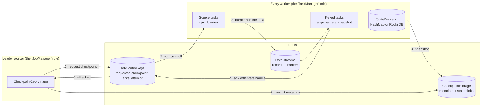

# Plan: build Redstream the way Flink works

Goal: build a stream processing engine on Redis that works like Flink: **operator chains,
keyed state backends, checkpoint barriers, a checkpoint coordinator and global recovery**.
Each step maps to one Flink concept, so each step can also be one blog chapter.

The engine itself is removed so you can write it. What is left:

- the user API (`api`): `DataStream`, `keyBy`, `KeyedProcessFunction`, `ValueState`, serdes;
- the planner (`plan`): turns a job into stages and key groups;
- the Redis client (`redis`): `RedisOps`, `KeySpace`, `PartitionKeys`, `LuaScript`;
- worker membership and partition leases (`coord`), and the `Worker` that hosts tasks;
- interfaces for everything you build, and tests for every step.

[DESIGN.md](DESIGN.md) describes the design you are building towards.

---

## How to work through it

1. Pick the next step. Read its **Flink concept** and **TODO** list.
2. Write the code. The interfaces are already there; Javadoc on each one says what it must do.
3. Open [Impl.java](runtime/src/test/java/io/redstream/runtime/Impl.java) and replace the
   `notYet(...)` line for what you built with a call to your class.
4. Run the step's tests (commands below). They were **skipped** until step 3; now they run.
5. Tick the boxes, commit, write the blog notes.

### Running the tests

Test method names start with the step they belong to (`step2_...`), so you can run one step:

```sh
# unit tests (no Redis)
./gradlew :runtime:test --tests '*HeapStateBackendTest.step1*'

# tests that need Redis (uses Docker, or REDSTREAM_REDIS_URI if set)
./gradlew :runtime:integrationTest --tests '*RedisCheckpointStorageIT.step2*'
./gradlew :runtime:integrationTest --tests '*EndToEndIT.step1*'
```

A test whose piece is not wired into `Impl.java` yet is reported as skipped, with a message
saying which step to do. The one exception is `EndToEndIT.step1`: it has no hook and fails
(times out) until step 1 works, because it is the first thing to build.

### Looking at the old implementation

An earlier version of Redstream (per-batch atomic commits, close to Kafka Streams) is in commit
`37e2115`. It is useful to read for the parts that carry over, such as the operators and the
task loop:

```sh
git tag per-batch-commit 37e2115     # once, to give it a name
git show per-batch-commit:runtime/src/main/java/io/redstream/runtime/operator/OperatorChain.java
git show per-batch-commit:runtime/src/main/java/io/redstream/runtime/PartitionTask.java
```

---

## Where we are going



## What you build, and where it plugs in

| Interface or stub | Flink equivalent | Step | Tests |
| --- | --- | --- | --- |
| [Operator](runtime/src/main/java/io/redstream/runtime/operator/Operator.java), [TaskContext](runtime/src/main/java/io/redstream/runtime/operator/TaskContext.java) | `StreamOperator`, operator chaining | 1 | `EndToEndIT.step1` |
| [StreamTask](runtime/src/main/java/io/redstream/runtime/StreamTask.java) (stub) | `StreamTask` | 1, 4, 5 | `EndToEndIT` |
| [StateBackend](runtime/src/main/java/io/redstream/runtime/state/StateBackend.java), [KeyedStateBackend](runtime/src/main/java/io/redstream/runtime/state/KeyedStateBackend.java) | `StateBackend`, `KeyedStateBackend` | 1, 2, 6 | `HeapStateBackendTest`, `RocksDbStateBackendTest` |
| [KeyedStateHandle](runtime/src/main/java/io/redstream/runtime/state/KeyedStateHandle.java) | `KeyedStateHandle` | 2 | same |
| [CheckpointStorage](runtime/src/main/java/io/redstream/runtime/checkpoint/CheckpointStorage.java), [CheckpointMetadata](runtime/src/main/java/io/redstream/runtime/checkpoint/CheckpointMetadata.java) | `CheckpointStorage`, `_metadata` | 2 | `RedisCheckpointStorageIT` |
| [LeaderElection](coord/src/main/java/io/redstream/coord/LeaderElection.java) | JobManager leader election | 3 | `LeaderElectionIT` |
| [JobControl](runtime/src/main/java/io/redstream/runtime/checkpoint/JobControl.java), [TaskSnapshot](runtime/src/main/java/io/redstream/runtime/checkpoint/TaskSnapshot.java) | JobManager ↔ TaskManager RPC | 3 | `JobControlIT` |
| [CheckpointCoordinator](runtime/src/main/java/io/redstream/runtime/checkpoint/CheckpointCoordinator.java) | `CheckpointCoordinator` | 3 | `CheckpointCoordinatorIT` |
| [CheckpointConfig](api/src/main/java/io/redstream/api/CheckpointConfig.java) | `env.enableCheckpointing` | 4 | `EndToEndIT.step4` |
| [CheckpointBarrier](runtime/src/main/java/io/redstream/runtime/checkpoint/CheckpointBarrier.java), [CheckpointBarrierHandler](runtime/src/main/java/io/redstream/runtime/checkpoint/CheckpointBarrierHandler.java) | `CheckpointBarrier`, aligned barrier handler | 4, 5 | `BarrierHandlerTest`, `EndToEndIT.step5` |
| [CheckpointListener](runtime/src/main/java/io/redstream/runtime/checkpoint/CheckpointListener.java) | `CheckpointListener` | 3, 7 | — |
| [TwoPhaseCommitSink](runtime/src/main/java/io/redstream/runtime/sink/TwoPhaseCommitSink.java) | `TwoPhaseCommitSinkFunction` | 7 | `TwoPhaseCommitSinkIT`, `EndToEndIT.step7` |
| [CrashPoint](runtime/src/main/java/io/redstream/runtime/fault/CrashPoint.java), [FaultHooks](runtime/src/main/java/io/redstream/runtime/fault/FaultHooks.java) | — (test support) | 4 | `EndToEndIT` |

## New Redis keys (proposal)

Job-level keys share the `{job}` hash tag, so one Lua script can update them together. Add
every new name to [KeySpace](redis/src/main/java/io/redstream/redis/KeySpace.java) or
[PartitionKeys](redis/src/main/java/io/redstream/redis/PartitionKeys.java); nothing else builds key names.

| Key | Type | Contents | Step |
| --- | --- | --- | --- |
| `{job}:ckpt:<id>:meta` | STRING | Serialized `CheckpointMetadata` | 2 |
| `{job}:ckpt:latest` | STRING | Id of the latest completed checkpoint | 2 |
| `{job}:blob:<name>` | STRING (or chunks) | State blob | 2 |
| `{job}:leader` | STRING, TTL | Leader worker id | 3 |
| `{job}:control` | HASH | `leader_epoch`, `attempt`, `requested_id`, `requested_ts` | 3 |
| `{job}:ckpt:<id>:acks` | HASH | field = partition, value = serialized `TaskSnapshot` | 3 |
| `{job}:ckpt:<id>:declines` | HASH | field = partition, value = reason | 3 |
| `{job:sS:pP}:in:a<attempt>` | STREAM | Keyed input for one attempt (old attempts are deleted) | 5 |

---

## Step 1. Run a job, no fault tolerance yet

**Flink concepts:** tasks, operator chaining, keyed state, key groups, the shuffle.

The goal is a correct word count on one worker that never crashes. Everything after this step
is about surviving failures.

- [ ] `HashMapStateBackend` and its `KeyedStateBackend`: one `HashMap<Bytes, byte[]>`, plus the
  current key. `snapshot` can throw `UnsupportedOperationException` for now.
- [ ] `ValueStateImpl<T>`: a `ValueState` that reads and writes the backend at
  `StateKeys.encode(operatorId, name, currentKey)`.
- [ ] Operators, each implementing [Operator](runtime/src/main/java/io/redstream/runtime/operator/Operator.java):
  map, flatMap, filter, fan-out (one input, several downstream operators), keyed process (sets
  the current key, then calls the user function), shuffle (picks the key group with
  `KeyGroups.keyGroupFor` and emits to its input stream), sink (emits to the sink stream).
- [ ] `OperatorChain`: builds a stage's operators back to front from the `Stage`, so each
  operator's downstream exists when it is created.
- [ ] `StreamTask.run()`: create the state backend (keyed stages only), build and open the chain,
  then loop: `xread` a batch, deserialize, `chain.process(...)`, send what was emitted.
- [ ] Implement `TaskContext` inside `StreamTask` (or a small class next to it).
- [ ] Wire `Impl.heapStateBackend()`.

Hints:

- Entries written by a shuffle or sink carry `v` (the value), `ts` (event time) and `p` (the
  producer id), from [MetaFields](redis/src/main/java/io/redstream/redis/MetaFields.java).
  Source streams carry the payload in `RedisStreamSource.payloadField()` (default `v`).
- Keep the task's read position in a local variable for now. Without checkpoints, a restarted
  task starts from the beginning, which is fine for this step.
- `KeyedProcessFunction` suppliers must return a new instance per task, because the function
  keeps its state handles in fields. Fail fast if a supplier returns the same instance twice.
- WindowedStream (`window().reduce()`) can stay unsupported: event time is a stretch goal.

**Done when:**

```sh
./gradlew :runtime:test --tests '*HeapStateBackendTest.step1*'
./gradlew :runtime:integrationTest --tests '*EndToEndIT.step1*'
```

---

## Step 2. Snapshots and checkpoint storage in Redis

**Flink concepts:** state snapshots, state handles, `CheckpointStorage`.

- [ ] `HashMapStateBackend.snapshot(id)`: serialize the map into one blob, `putBlob`, return a
  `KeyedStateHandle` with the backend's name.
- [ ] Restore in `createKeyedStateBackend(ctx, handle)`: check `handle.backend()`, read the
  blob, fill the map.
- [ ] `RedisCheckpointStorage`: blobs, checkpoint metadata, the latest pointer, `discard`.
- [ ] Wire `Impl.redisCheckpointStorage(...)`.

Hints:

- Blob format: a version byte, the entry count, then `[key length][key][value length][value]`
  per entry, with `DataOutputStream`.
- `CheckpointMetadata` and `TaskSnapshot` need a serializer too. Hand-written binary or JSON
  both work; keep it in one class. `TaskSnapshot.operatorState` holds byte arrays.
- Blob names: `s<stage>p<partition>/ckpt-<id>/state`.
- `commitCheckpoint` must check the leader epoch, but leaders arrive in step 3. For now, treat
  "no leader yet" as epoch 0, so the tests' epoch 1 passes. Write it as a Lua script that
  checks the epoch and then writes the metadata and the latest pointer.

**Done when:**

```sh
./gradlew :runtime:test --tests '*HeapStateBackendTest*'
./gradlew :runtime:integrationTest --tests '*RedisCheckpointStorageIT.step2*'
```

---

## Step 3. Leader and checkpoint coordinator

**Flink concepts:** JobManager, `CheckpointCoordinator`, pending and completed checkpoints,
acknowledgements, fencing.

- [ ] `RedisLeaderElection` in `coord`: like `LeaseManager`, on `{job}:leader`, with the epoch in
  `{job}:control`.
- [ ] Fencing: `commitCheckpoint` and `JobControl`'s coordinator writes throw
  `FencedException` when the caller's epoch is lower than `{job}:control.leader_epoch`.
- [ ] `RedisJobControl`: requested checkpoint, attempt, acks and declines.
- [ ] `DefaultCheckpointCoordinator`: `IDLE → PENDING(id) → COMPLETED | ABORTED`, with a clock
  passed in so tests control time.
- [ ] On completion: commit metadata, `discard` older checkpoints (keep the last 1 to 3 and
  every savepoint).
- [ ] In `Worker.reconcile()`, try to become leader; create a coordinator for each term and
  `start()` it, and close it when leadership is lost.
- [ ] Wire `Impl.leaderElection`, `Impl.jobControl`, `Impl.checkpointCoordinator`.

Hints:

- "All acked" means one ack for every partition in `Assignment.allPartitions(...)`.
- Checkpoint ids must keep increasing across leaders: a new coordinator continues after the
  highest id requested so far, not from 1.
- `poll()` must be safe to call any number of times.

**Done when:**

```sh
./gradlew :runtime:integrationTest --tests '*LeaderElectionIT*' --tests '*JobControlIT*' --tests '*CheckpointCoordinatorIT*'
```

---

## Step 4. Checkpoint a running job (no keyBy yet)

**Flink concepts:** `enableCheckpointing`, barrier injection at sources, source offsets as
operator state, restore from the latest checkpoint, global restart.

- [ ] `StreamEnvironment.enableCheckpointing(CheckpointConfig)`, carried through
  `JobDefinition` into `JobGraph`. Wire `Impl.enableCheckpointing`.
- [ ] Source tasks poll `requestedCheckpoint()` between batches. When it moves past the last
  one they handled: ack a `TaskSnapshot` with the last processed entry id as `sourceOffset`.
- [ ] On start, load `latestCompleted()` and resume each source after its `sourceOffset`.
- [ ] Global restart: when a task fails, the leader calls `requestRestart`. Every worker sees
  the new attempt, stops all its tasks and starts them again from the latest checkpoint.
- [ ] Ownership changes (a worker joining or leaving) need a global restart too: one partition
  restored on its own would be at a different point in time from the rest.
- [ ] Call `FaultHooks.at(...)` at each `CrashPoint` in `StreamTask`.

Hints:

- This is where recovery becomes Flink's: one failure rewinds the whole job, not one
  partition. That is the biggest trade-off; write it down for the blog.
- Sinks are still plain appends, so output is **at-least-once** after a restart. The step 4
  test only checks that nothing is lost.

**Done when:**

```sh
./gradlew :runtime:integrationTest --tests '*EndToEndIT.step4*'
```

---

## Step 5. Barriers across keyBy, with alignment

**Flink concepts:** barriers through the shuffle, aligned checkpoints, in-flight data.

- [ ] Add a kind field (record or barrier) to stream entries in `MetaFields`.
- [ ] A source task that handles a checkpoint request writes the barrier to **every**
  downstream key group's input stream, even ones it sent no data to.
- [ ] `AligningBarrierHandler`: expects a barrier from every upstream partition. Wire
  `Impl.barrierHandler`.
- [ ] When aligned: `snapshot(id)`, ack with the `KeyedStateHandle`, then process
  `drainBuffered()` before reading more input. Forward the barrier downstream if the stage
  has a shuffle output.
- [ ] Keyed tasks restore their state from the latest checkpoint's `KeyedStateHandle`.
- [ ] On a global restart, delete in-flight data: keyed input streams of old attempts.

Hints:

- Why there is no dedup: after a restart, everything after the checkpoint is replayed from the
  sources and the old in-flight data is gone, so nothing is processed twice.
- Naming input streams by attempt (`:in:a<attempt>`) makes cleanup a matter of deleting old
  keys, with no race against a zombie still writing to them.

**Done when:**

```sh
./gradlew :runtime:test --tests '*BarrierHandlerTest*'
./gradlew :runtime:integrationTest --tests '*EndToEndIT.step5*'
```

---

## Step 6. RocksDB state backend and incremental checkpoints

**Flink concepts:** `EmbeddedRocksDBStateBackend`, local state on disk, incremental
checkpoints, shared state.

- [ ] Add `org.rocksdb:rocksdbjni` to [libs.versions.toml](gradle/libs.versions.toml) and to `runtime`.
- [ ] `EmbeddedRocksDBStateBackend`: one RocksDB per key group under `ctx.localDir()`.
- [ ] Full snapshot first: `org.rocksdb.Checkpoint.createCheckpoint(dir)`, then upload every
  file. Restore: download into a fresh directory and open it.
- [ ] Incremental: upload only SST files not uploaded before. The handle lists every file the
  checkpoint needs.
- [ ] `discard` counts references, so a shared SST blob is deleted only when no kept checkpoint
  uses it.
- [ ] `WorkerConfig.withStateBackend(...)` and `withLocalStateDir(...)`. Wire
  `Impl.rocksDbStateBackend` and `Impl.withRocksDb`.

Hints:

- SST files never change once written, which is what makes incremental checkpoints safe.
  `MANIFEST`, `CURRENT` and `OPTIONS` change, so upload them every time.
- Blob names for SST files must end in `.sst` and stay the same across checkpoints (the tests
  rely on both), for example `s1p3/shared/000012.sst`.

**Done when:**

```sh
./gradlew :runtime:test --tests '*RocksDbStateBackendTest*'
./gradlew :runtime:integrationTest --tests '*RedisCheckpointStorageIT.step6*' --tests '*EndToEndIT.step6*'
```

---

## Step 7. Exactly-once output with a two-phase-commit sink

**Flink concepts:** `TwoPhaseCommitSinkFunction`, `notifyCheckpointComplete`, end-to-end
exactly-once.

- [ ] `RedisTwoPhaseCommitSink`: a transaction is a staging stream, for example
  `{job}:txn:<task>:<checkpoint id>`.
- [ ] `preCommit` at the barrier; store the transaction in `TaskSnapshot.operatorState`.
- [ ] `commit` on `notifyCheckpointComplete`: a Lua script that copies the staging stream into
  the sink stream, deletes it, and records that it was committed, so a second call does nothing.
- [ ] On restore: `commit` every transaction in the snapshot, `abort` any others.
- [ ] Use it for every sink when checkpointing is on. Wire `Impl.redisStreamSink` and
  `Impl.sinksAreTransactional`.

Hints:

- Output now appears once per checkpoint instead of right away: the latency cost of
  exactly-once output, in Flink too.

**Done when:**

```sh
./gradlew :runtime:integrationTest --tests '*TwoPhaseCommitSinkIT*' --tests '*EndToEndIT.step7*'
```

---

## Step 8. Savepoints and rescaling

**Flink concepts:** savepoints, restoring with a different parallelism, key groups.

- [ ] A way to request a savepoint, for example a `{job}:control` field the leader watches.
  Wire `Impl.triggerSavepoint`.
- [ ] Never `discard` savepoints automatically.
- [ ] Restart with a different number of workers from the savepoint. Key groups stay the same,
  so only their owners change.

Hints:

- Key groups make rescaling cheap, the same reason Flink has them. Changing `maxParallelism`
  would need state rewritten into new key groups; leave that as a stretch goal.

**Done when:**

```sh
./gradlew :runtime:integrationTest --tests '*EndToEndIT.step8*'
```

---

## Step 9. Document

- [ ] Update [DESIGN.md](DESIGN.md) with what you learned and any decisions that changed.
- [ ] Update [README.md](README.md): Java 25, and the "How it works" paragraph.
- [ ] Write the chapter in [docs/](docs/), using your notes from each step.

## Stretch goals

- **Asynchronous snapshots:** snapshot synchronously, upload in the background.
- **Unaligned checkpoints:** store in-flight records in the snapshot instead of waiting.
- **Event time and windows:** watermarks travel through the same streams as barriers.
- **Filesystem checkpoint storage:** a second `CheckpointStorage`, to show it is pluggable.
