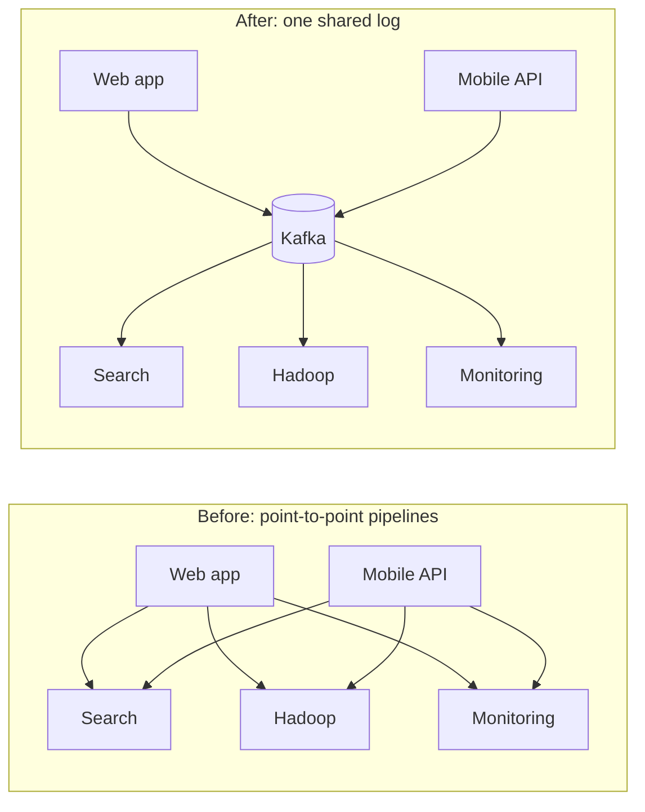
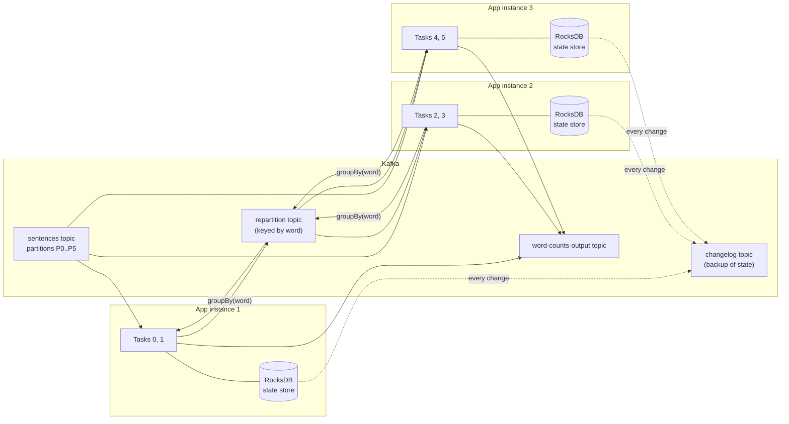
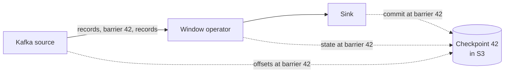
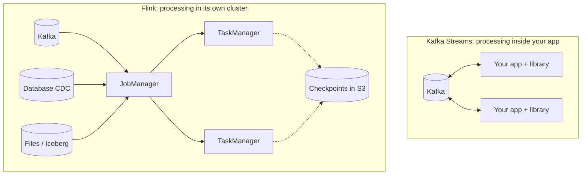

# From Kafka to Flink: How Stream Processing Grew Up

Stream processing means acting on data the moment it arrives, instead of collecting it first
and processing it later. Kafka gave us a place to keep that moving data. Libraries like Kafka
Streams let us process it with plain application code. Flink appeared when the processing
itself got too big and too tricky for a library.

This chapter walks through that story in four steps:

1. [Why streams at all](#why-streams-at-all)
2. [How Kafka evolved](#how-kafka-evolved-from-a-log-to-a-streaming-platform)
3. [How a stream processing library works on top of Kafka](#how-a-stream-processing-library-works-on-top-of-kafka)
4. [Why Flink was needed](#why-flink-was-needed)

Then it applies all of it to [real use cases](#use-cases-which-tool-fits-and-why), gives a
[side-by-side comparison](#side-by-side-comparison), and shows
[where Redstream fits](#where-redstream-fits).

---

## Why streams at all

Think of a bank.

- **Batch:** every night at 2 a.m., a job reads all of the day's transactions and flags
  anything suspicious. A stolen card can be used all day before anyone notices.
- **Stream:** every transaction is checked as it happens. A suspicious payment is blocked
  within seconds.

The data is the same in both cases. Only the timing changes. Batch asks "what happened
yesterday?" Streaming asks "what is happening right now?"

A useful way to picture a stream is a **never-ending table**. A batch job reads a table that
has an end. A stream job reads a table that keeps growing, so it can never say "I am done".
That one fact is what makes stream processing hard. You have to decide:

- how to count things that never finish,
- how to remember what you have already seen, and
- how to recover when a machine dies halfway through.

Every tool in this chapter is a different answer to those three questions.

---

## How Kafka evolved: from a log to a streaming platform

Kafka started as a pipe and slowly became a platform. Each step added one piece that
stream processing needed.

### The problem at LinkedIn

Around 2010, LinkedIn had dozens of systems that needed the same data: page views, searches,
profile updates. Every pair of systems had its own custom pipeline. With N producers and M
consumers, that is up to N × M pipelines, each one fragile.



The fix was one central **log**: an append-only list of events that anyone can write to and
anyone can read from, at their own pace. That log is Kafka.

### The ideas that made Kafka different

- **Events are kept, not deleted on read.** A traditional queue removes a message once it is
  consumed. Kafka keeps events for days, weeks or forever. A new consumer can start from the
  beginning and replay history.
- **Each reader tracks its own position.** That position is called the **offset**. Ten
  different teams can read the same topic at ten different speeds.
- **Topics are split into partitions.** A partition is one ordered log. Spreading a topic over
  many partitions spreads the load over many machines. Events with the same key always go to
  the same partition, so order is kept per key.

### Milestones

| Year | Milestone | Why it mattered for streaming |
| --- | --- | --- |
| 2011 | Kafka open-sourced by LinkedIn | A shared, replayable log of events |
| 2012 | Becomes an Apache top-level project | Wide adoption beyond LinkedIn |
| 2013 | Replication (Kafka 0.8) | Data survives a broker failure, so it can be trusted |
| 2013 | Apache Samza open-sourced by LinkedIn | First stream processor designed around Kafka |
| 2014 | Confluent founded by Kafka's creators | A company focused on Kafka as a platform |
| 2015 | Kafka Connect (0.9) | Ready-made connectors to move data in and out of databases and stores |
| 2016 | Kafka Streams (0.10) | Stream processing as a plain Java library |
| 2017 | Exactly-once semantics (0.11) | Transactions: results are correct even after crashes |
| 2017 | KSQL announced (later ksqlDB) | Stream processing with SQL on top of Kafka Streams |
| 2021–2022 | KRaft mode (2.8 preview, 3.3 production ready) | Kafka manages its own metadata, no ZooKeeper cluster needed |
| 2025 | Kafka 4.0 | ZooKeeper removed for good; early access to queue-style consumption |

The direction is clear. Kafka went from "store and move events" to "store, move **and
process** events".

---

## How a stream processing library works on top of Kafka

Kafka Streams is not a separate system. It is a Java library you add to your normal
application, and it uses Kafka itself for almost everything hard: spreading work, storing
state and recovering from crashes. If you can run a Spring Boot service, you can run a stream
processor.

### The classic example: word count

```java
StreamsBuilder builder = new StreamsBuilder();

KStream<String, String> lines = builder.stream("sentences");

KTable<String, Long> counts = lines
    .flatMapValues(line -> Arrays.asList(line.toLowerCase().split("\\W+")))
    .groupBy((key, word) -> word)           // re-key every record by the word
    .count(Materialized.as("word-counts")); // keep a running count per word

counts.toStream().to("word-counts-output");
```

These few lines hide six big ideas. Here is the picture first, then each idea in turn.



Kafka sits in the middle of everything. The app instances only hold work in progress; Kafka
holds the input, the shuffled data, the backup of the state, and the output.

### 1. The topology: a pipeline of small steps

Your code builds a **topology**, a graph of steps. Records flow from a **source** (the
`sentences` topic), through **processors** (split, group, count), to a **sink** (the
`word-counts-output` topic). Nothing runs until you call `streams.start()`.

### 2. Partitions become tasks, tasks spread across copies of your app

A Kafka topic is split into **partitions**. Kafka Streams creates one **task** per input
partition. Start three copies of your app with the same `application.id` and they form a
consumer group. Kafka hands each copy a share of the tasks.

- 6 partitions and 3 app instances means 2 tasks each.
- One instance dies, and its tasks move to the other two automatically.
- The catch: the number of partitions is the ceiling. With 6 partitions, a 7th instance has
  nothing to do.

### 3. Re-keying needs a repartition topic

Counting words needs every "kafka" record to reach the same task. The input is keyed by
sentence, not by word. So `groupBy` makes Kafka Streams write the records to an internal
**repartition topic**, keyed by word, and read them back. Kafka's normal rule, same key goes
to the same partition, does the rest. This costs one extra trip through Kafka, so re-keying is
not free.

### 4. State lives next to the code, with a backup copy in Kafka

A running count is **state**. Each task keeps its state in a local **state store**, usually
RocksDB on the app's disk, so reads are fast. Every change is also written to a **changelog
topic** in Kafka. If the machine is lost, another instance replays the changelog and rebuilds
the store. Optional **standby replicas** keep a warm copy on another instance so recovery
takes seconds, not minutes.

### 5. Streams and tables are two views of the same data

- A **KStream** is a list of events: "Asha paid 100", "Asha paid 50".
- A **KTable** is the latest value per key: "Asha's total is 150".

Count a stream and you get a table. Turn a table's updates back into events and you get a
stream. This **stream-table duality** is the core idea behind Kafka Streams and ksqlDB.

### 6. Time windows and exactly-once

Most real questions have a time box: clicks *per minute*, payments *in the last hour*. Kafka
Streams supports four kinds of **windows**:

| Window | What it means | Example |
| --- | --- | --- |
| Tumbling | Fixed, non-overlapping blocks | Orders per minute |
| Hopping | Fixed size, overlapping steps | 5-minute average, updated every minute |
| Sliding | Defined by how close two events are in time | Two logins within 10 seconds |
| Session | Grows while activity continues, closes after a quiet gap | A user's visit to a website |

Events can arrive late, so a window stays open for a **grace period** before its result is
final.

Finally, setting `processing.guarantee=exactly_once_v2` makes Kafka Streams wrap three things
in one Kafka **transaction**: the input offsets it read, the state changes it made, and the
output it wrote. After a crash, either all three happened or none did. A payment is counted
once, never twice.

---

## Why Flink was needed

A library inside your app is great until the job outgrows the app. Flink is a separate engine
built only for stream processing. It takes over the hard parts that a library leaves to you:
huge state, correct handling of late data, many kinds of sources, and running batch and
streaming the same way.

### Where a library starts to hurt

- **Kafka in, Kafka out.** Kafka Streams reads from Kafka and writes to Kafka. If your data
  also lives in files, databases or another queue, you first have to copy it into Kafka.
- **Partitions cap your scale.** You can never have more busy instances than input
  partitions. Adding partitions later changes which partition each key goes to, which is
  painful.
- **Big state recovers slowly.** Rebuilding a 500 GB state store means replaying 500 GB of
  changelog. A crash can turn into an hour of catching up.
- **Time is simple, not rich.** Kafka Streams tracks time per partition and closes windows
  after a grace period. It has no single, job-wide sense of "how far along in time are we?"
- **It is your app's problem.** Scaling, upgrades and monitoring are done the same way as for
  any other service you run.

### What earlier tools got wrong

Flink did not appear in a vacuum. It grew out of Stratosphere, a research project in Berlin,
and joined Apache in 2014. Two popular tools came before it, and each had a gap.

| Tool | Strength | Gap |
| --- | --- | --- |
| Apache Storm | Very low latency, one event at a time | No built-in state, and results could be wrong or doubled after a failure |
| Spark Streaming | Correct results, reused Spark's batch engine | Worked in small batches, so latency was seconds, not milliseconds |

Flink set out to give both: true one-event-at-a-time streaming **and** correct results with
large state.

### What Flink adds

**1. Event time and watermarks.** Every event carries the time it *happened*, not the time it
*arrived*. A phone that was offline in a tunnel may send a 10:01 tap at 10:07. A
**watermark** is a marker flowing through the job that says "I don't expect anything older
than 10:05 any more." When the watermark passes the end of a window, Flink closes it. This
gives correct per-minute counts even when data shows up out of order.

```text
events arrive:   10:02  10:03  10:01(late)  10:04  10:06   ...
watermark:                         W(10:00)               W(10:05)
                                                              |
                         window [10:00, 10:05) closes here ---+
                         and includes the late 10:01 event
```

**2. Checkpoints instead of replaying a changelog.** Every few seconds, Flink takes a
consistent snapshot of all the state in the job and saves it to durable storage such as S3.
It does this by sending special **barrier** markers through the data, so it never has to stop
the job. After a crash, Flink loads the last snapshot, rewinds the sources to the matching
position and carries on. A **savepoint** is the same snapshot taken on purpose, so you can
upgrade code or change parallelism without losing state.



**3. Any source, any sink.** Kafka, Kinesis, Pulsar, files, Apache Iceberg tables and
database change streams (CDC) all plug in through connectors. Kafka becomes one input among
many, not a requirement.

**4. Parallelism you choose per step.** Each step in a Flink job has its own parallelism.
The step that reads Kafka is still limited by partitions, but a heavy step after it can run
on many more slots.

**5. One engine for batch and streaming.** To Flink, a file is just a stream that ends. The
same code and the same SQL can backfill a year of history and then keep running on live data.

**6. Higher-level tools.** Flink SQL lets analysts write streaming queries. The CEP library
finds patterns, such as "three failed logins and then a password change within five
minutes". `ProcessFunction` with timers gives full low-level control when you need it.

### The price

Flink is a cluster you have to run: a **JobManager** that plans and coordinates, and
**TaskManagers** that do the work. That is more to learn and more to operate than a library.
Many teams use a managed Flink service to avoid running it themselves.



---

## Use cases: which tool fits and why

The same question to ask every time: **how much state, how messy is time, and where does the
data come from?**

### 1. Trending words or hashtags

*Count how often each word appears in posts, per 5 minutes.*

- **State:** one counter per word. Small.
- **Time:** posts arrive roughly in order.
- **Sources:** one Kafka topic.

**Fit: Kafka Streams.** This is the word count example with a tumbling window. A small
service, no extra cluster.

### 2. Order service keeping live stock levels

*Every order and every delivery changes the stock count of a product. Other services ask
"how many of item 123 are left?"*

- **State:** one number per product. A KTable.
- **Time:** order of events per product matters, the clock does not.
- **Sources:** order and delivery topics, both in Kafka.

**Fit: Kafka Streams.** The state lives inside the inventory service itself, and Kafka
Streams' **interactive queries** let that service answer reads straight from its local state
store. The stream processor *is* the microservice.

### 3. Card fraud detection

*Block a card if it is used in two countries within 10 minutes, or after three declined
payments in a row.*

- **State:** recent payments per card. Medium.
- **Time:** short windows; a few seconds of delay matters.
- **Sources:** payments in Kafka, plus customer profiles from a database.

**Fit: either, depending on the rules.** Simple rules ("more than 5 payments a minute") work
well in Kafka Streams. Patterns made of several steps ("decline, decline, decline, then
success abroad") are what Flink's CEP library was built for.

### 4. Website sessions from a mobile app

*Group each user's clicks into visits that end after 30 minutes of silence, then report
visit length and pages per visit.*

- **State:** open sessions for millions of users.
- **Time:** messy. Phones go offline and send old clicks later.
- **Sources:** one click topic.

**Fit: Flink.** Session windows exist in both tools, but late, out-of-order mobile data is
exactly what event time and watermarks handle well. A click that arrives 20 minutes late
still lands in the right visit.

### 5. IoT sensors in factories

*Ten thousand machines each send a temperature reading every second. Alert if a machine's
5-minute average goes above a limit.*

- **State:** a rolling average per machine, plus history for model features. Large.
- **Time:** devices buffer and send in bursts, so data is often late.
- **Sources:** MQTT or Kinesis, not always Kafka.

**Fit: Flink.** Many non-Kafka sources, large state, and late data all point the same way.
Checkpoints keep recovery fast even with a lot of state.

### 6. Ride-hailing surge pricing

*Every minute, for each city area, compare ride requests with available drivers and set a
price multiplier.*

- **State:** counts per area for two different streams, joined together.
- **Time:** must be correct per minute; drivers' GPS updates arrive out of order.
- **Sources:** requests and driver locations, possibly from different systems.

**Fit: Flink.** Joining two high-volume streams on time windows, with event time, at large
scale, is Flink's home ground.

### 7. Copying database changes into a data lake

*Every insert, update and delete in the orders database should appear in an Iceberg table
within a minute, for analysts.*

- **State:** little, mostly passing data through.
- **Time:** order per row matters.
- **Sources:** the database's change log (CDC).

**Fit: Kafka Connect, or Flink CDC.** If the changes already flow through Kafka, a Kafka
Connect sink is the simplest answer. If you also want to clean, join or reshape the data on
the way, Flink can read the database changes directly and write to Iceberg in one job.

### Summary of the use cases

| Use case | State size | How messy is time | Sources | Best fit |
| --- | --- | --- | --- | --- |
| Trending words | Small | Low | Kafka | Kafka Streams |
| Live stock levels | Small | Low | Kafka | Kafka Streams |
| Card fraud | Medium | Medium | Kafka + database | Kafka Streams or Flink (CEP) |
| Mobile sessions | Large | High | Kafka | Flink |
| IoT sensors | Large | High | MQTT, Kinesis | Flink |
| Surge pricing | Large | High | Several streams | Flink |
| Database to data lake | Small | Low | Database CDC | Kafka Connect or Flink CDC |

---

## Side-by-side comparison

| | Kafka Streams | ksqlDB | Flink |
| --- | --- | --- | --- |
| What it is | Java library inside your app | SQL server built on Kafka Streams | Separate processing cluster |
| You write | Java code | SQL | Java, Python or SQL |
| Sources and sinks | Kafka only | Kafka only | Kafka and many others |
| Scaling limit | Input partitions | Input partitions | Per-step parallelism |
| State backup | Changelog topics in Kafka | Changelog topics in Kafka | Snapshots (checkpoints) in object storage |
| Late data | Grace period per window | Grace period per window | Event time with watermarks |
| Batch jobs | No | No | Yes, same engine |
| What you operate | Your app | ksqlDB servers | A Flink cluster, or a managed service |
| Best for | Event-driven microservices | Quick streaming queries on Kafka | Large, complex, time-sensitive pipelines |

### A simple decision guide

1. **Is all your data in Kafka, and is the logic part of one service?** Start with Kafka
   Streams.
2. **Do you just need filters, joins and aggregates, written by people who prefer SQL?** Try
   ksqlDB or Flink SQL.
3. **Do you read from several kinds of systems, keep a lot of state, or care about correct
   results for late data?** Use Flink.
4. **Not sure?** Start with the simplest tool that works today. The ideas you learn, such as
   partitions, keyed state, windows and exactly-once, carry over to every other tool.

---

## Where Redstream fits

[Redstream](../README.md), the engine in this repository, borrows Flink's programming model
and runs it on Redis, the same way Kafka Streams runs on Kafka.

| Idea from this chapter | Kafka Streams | Flink | Redstream |
| --- | --- | --- | --- |
| Where the data flows | Kafka topics | Any source | Redis Streams |
| API style | KStream / KTable | DataStream (`keyBy`, `process`, windows) | DataStream, like Flink |
| Where state lives | RocksDB + changelog topic | RocksDB or memory + checkpoints | Redis hashes |
| How exactly-once works | Kafka transactions | Global checkpoints with barriers | One Lua script per batch commits state, outputs and offset together |
| How work is spread | Consumer group over partitions | JobManager assigns slots | Identical workers holding leases on partitions |

That makes it a good teaching tool: each design choice in Redstream is one of the choices
this chapter described, made in a small enough codebase to read end to end. See
[DESIGN.md](../DESIGN.md) for the details.

---

## Key takeaways

- A stream is a table that never ends. The hard problems are counting, remembering and
  recovering.
- Kafka made events durable and replayable. That is what made reliable stream processing
  possible.
- Kafka Streams turns stream processing into a library by leaning on Kafka for partitioning,
  state backup and transactions.
- Flink exists for jobs that outgrow a library: many sources, huge state, messy time, and
  batch plus streaming in one engine.

## Glossary

| Term | Meaning in one line |
| --- | --- |
| Topic | A named stream of events in Kafka |
| Partition | One ordered slice of a topic; the unit of parallel work |
| Offset | A reader's position in a partition |
| Consumer group | Readers sharing the work of a topic, each partition read by one of them |
| Task | Kafka Streams' unit of work, one per input partition |
| State store | Local storage a task uses to remember things, such as counts |
| Changelog topic | A Kafka topic that backs up every change to a state store |
| Repartition topic | An internal topic used to re-key records so the same key meets the same task |
| KStream / KTable | Events as they happen / the latest value per key |
| Window | A time box for grouping events: tumbling, hopping, sliding or session |
| Grace period | How long a window waits for late events before its result is final |
| Event time | When an event actually happened, as opposed to when it arrived |
| Watermark | A marker saying "no events older than this time are expected" |
| Checkpoint | Flink's automatic, consistent snapshot of all job state |
| Savepoint | A checkpoint you trigger yourself, for upgrades and rescaling |
| Exactly-once | Each event affects the result once, even after failures |
| CDC | Change data capture: reading a database's changes as a stream |
